# LapKart Architecture & Feature Audit Report

**Date:** October 14, 2026  
**Application:** LapKart (Spring Boot + React 19 + TailwindCSS + Three.js)  
**Scope:** Cart Management Service, Order Management Service, Platform Capabilities & Outstanding Work  

---

## 1. Executive Summary

| Subsystem | Implementation Status | Readiness |
|---|---|---|
| **Cart Management Service** | 🟡 **85% Complete** | Functional for authenticated users; missing guest cart & coupon engines. |
| **Order Management Service** | 🟡 **80% Complete** | Full end-to-end checkout & inventory deduction; missing real payment gateway & restocking logic. |
| **Admin Operations** | 🟢 **90% Complete** | Product, Category, User, and Order management with status updates are fully hooked up. |
| **Catalog & 3D Experience** | 🟢 **95% Complete** | 3D interactive hero, specs, brand/category filters, and responsive layout. |
| **Customer Account & Support** | 🔴 **40% Complete** | Missing saved addresses, profile editing, reviews hub, and email notifications. |

---

## 2. Cart Management Service Audit

### ✅ What is Currently Implemented:
* **Backend API (`CartController.java` & `CartService.java`)**:
  * `GET /api/cart` — Fetches current user's cart with calculated subtotals, item counts, and grand total.
  * `POST /api/cart/add` — Adds product or increments quantity with **live stock validation** and `isActive` checks.
  * `PUT /api/cart/items/{id}` — Updates quantity; automatically deletes item if quantity reaches zero.
  * `DELETE /api/cart/items/{id}` — Removes individual cart items.
  * `DELETE /api/cart/clear` — Clears the user's cart entirely.
  * **Dynamic Pricing Engine**: Automatically checks for `discountPrice` and applies effective pricing locked to active database rates.
* **Frontend State & UI (`cartStore.js` & `Cart.jsx`)**:
  * Zustand-based reactive store tracking items, counts, totals, and error states.
  * Full shopping cart interface with product thumbnails, live quantity steppers, item deletion, tax estimates, and free shipping calculations.
  * Shimmer loading state (`CartSkeleton`) during asynchronous fetches.
  * Empty cart state with quick redirect to catalog.

### ⚠️ What is Left / Missing in Cart Management:

1. **Guest Cart / Anonymous Shopping (Local Storage Merge)**:
   * *Current state:* If an unauthenticated user clicks *"Add to Cart"*, they are redirected to `/login`.
   * *Missing:* Allowing visitors to add laptops to `localStorage`, which automatically merges into the database cart upon login/registration.
2. **Coupons & Promo Code Engine**:
   * *Missing:* No `Coupon` entity, validation API (`POST /api/cart/apply-coupon`), or promo code input during checkout.
3. **Cart Stock & Price Change Alerts**:
   * *Missing:* If a product price changes or stock decreases while sitting in a user's cart, there is no visual alert banner notifying the user before checkout.
4. **Warranty & Hardware Add-ons**:
   * *Missing:* Extended warranty packages (e.g., +2 Year Accidental Damage Protection) selectable within the cart.

---

## 3. Order Management Service Audit

### ✅ What is Currently Implemented:
* **Backend Pipeline (`OrderController.java` & `OrderService.java`)**:
  * `POST /api/orders` — Atomically creates an order from the user's active cart.
  * **Inventory Deduction**: Automatically decrements physical `stockQuantity` from the `products` table upon order placement.
  * **Price Freezing**: Locks in `price_locked` in `order_items` to protect against future price fluctuations.
  * **Auto Cart Flush**: Clears the user's active cart upon successful order creation.
  * `GET /api/orders` — Retrieves authenticated user's order history sorted by creation date.
  * `GET /api/orders/{id}` & `GET /api/orders/number/{orderNumber}` — Fetches individual order details by ID or unique reference code.
  * **Order Reference Code**: Automatically generates unique tracking strings (e.g., `LPK-179197-8492`).
* **Admin Order Operations (`AdminOrders.jsx` & `AdminController.java`)**:
  * `GET /api/admin/orders` — Admin overview of all customer orders.
  * `PUT /api/admin/orders/{id}/status` — Changes order status (`Pending`, `Processing`, `Shipped`, `Delivered`, `Cancelled`) and payment status (`Pending`, `Paid`, `Failed`, `Refunded`).
* **Frontend Order Experience (`Checkout.jsx`, `OrderSuccess.jsx`, `Orders.jsx`)**:
  * Shipping address collection (Full Name, Phone, Street, City, State, PIN).
  * Choice of Cash on Delivery vs Online Payment.
  * Dedicated Order Success confirmation page with full breakdown.
  * Customer Order History dashboard with status badges and line item lists.

### ⚠️ What is Left / Missing in Order Management:

1. **Real Payment Gateway Integration (Stripe / Razorpay)**:
   * *Current state:* Payment method is recorded as a string ("Cash on Delivery" or "Online Payment") and initialized as `Pending`.
   * *Missing:* Real payment gateway integration with webhook listeners to automatically update `paymentStatus = "Paid"` after transaction confirmation.
2. **Order Cancellation & Stock Restocking**:
   * *Current issue:* If an order is marked `Cancelled`, the deducted stock is **NOT currently restored** to `product.stockQuantity`.
3. **Courier Partner & Tracking Number (AWB)**:
   * *Missing:* The `orders` database table does not yet have fields for `courier_name` (e.g. Bluedart, Delhivery) or `tracking_number`.
4. **Customer-Initiated Cancellation**:
   * *Missing:* Customers cannot cancel an order from their `/orders` page while it is still in `Pending` or `Processing` status; currently only admins can update status.
5. **Downloadable PDF Invoice**:
   * *Missing:* Customer ability to generate or download a GST-compliant tax invoice PDF from the order details screen.

---

## 4. Other Important Missing Parts Across the Platform

```mermaid
graph TD
    subgraph P0["P0: Production Critical"]
        A[Payment Gateway Webhook] --> B[Inventory Restocking on Cancel]
        B --> C[Order Cancellation by Customer]
    end

    subgraph P1["P1: High Value Features"]
        D[Saved Address Book] --> E[Customer Profile Management]
        E --> F[Guest Cart to User Cart Sync]
        F --> G[Email Notifications]
    end

    subgraph P2["P2: Polish & Growth"]
        H[Product Reviews & Ratings] --> I[Coupon / Discount Engine]
        I --> J[Wishlist System]
        J --> K[Server-side Pagination]
    end
```

### 1. Customer Profile & Address Book
* Users must currently re-type their full shipping address on every checkout.
* Missing: `user_addresses` table to store multiple delivery locations (Home, Office) with default selection.
* Missing: A `/profile` page for customers to change passwords, update phone numbers, and manage saved addresses.

### 2. Product Reviews & Ratings (The Feedback Hub)
* [Feedback.jsx](file:///d:/Projects/LapKart/frontend-lapkart/src/pages/Feedback.jsx) is currently a placeholder ("Under Active Construction").
* Missing: `reviews` table (`rating`, `comment`, `user_id`, `product_id`, `created_at`) and review submission form on product detail pages.

### 3. Email & SMS Notification System
* Currently, no emails are dispatched when:
  * An account is registered.
  * An order is placed (`Order Placed Confirmation`).
  * An order is shipped with tracking details.

### 4. Wishlist / Saved for Later
* No ability for users to save laptops to a personal Wishlist for future review.

### 5. Forgot Password / Password Reset Flow
* Registration and Login work via JWT, but there is no "Forgot Password" link or token-based reset email mechanism.

### 6. Contact Form Backend Hookup
* [Contact.jsx](file:///d:/Projects/LapKart/frontend-lapkart/src/pages/Contact.jsx) currently simulates submission via a local `setTimeout` rather than persisting inquiries to an admin messages table.

---

## 5. Recommended Priority Roadmap

| Priority | Feature | Effort | Impact |
|---|---|---|---|
| **P0** | **Restock Inventory on Cancelled Order** | 1–2 hours | Prevents permanent inventory leakage when orders are cancelled. |
| **P0** | **Customer Cancel Order Action** | 2–3 hours | Allows customers to cancel orders before dispatch without manual support. |
| **P1** | **Saved Address Book** | 3–4 hours | Greatly speeds up mobile and desktop checkout conversion. |
| **P1** | **Guest Cart (`localStorage`)** | 3–4 hours | Prevents forcing users to sign in before even adding an item. |
| **P1** | **Real Payment Gateway (Razorpay/Stripe)** | 4–6 hours | Enables real card/UPI/net-banking transactions. |
| **P2** | **Product Reviews & Verified Ratings** | 4–5 hours | Builds buyer trust and fills out the Feedback Hub. |
| **P2** | **Courier Tracking & PDF Invoice** | 3–4 hours | Professional post-purchase experience. |
| **P2** | **Email Notifications (Spring Mail)** | 3–4 hours | Automated order receipts and shipping alerts. |
